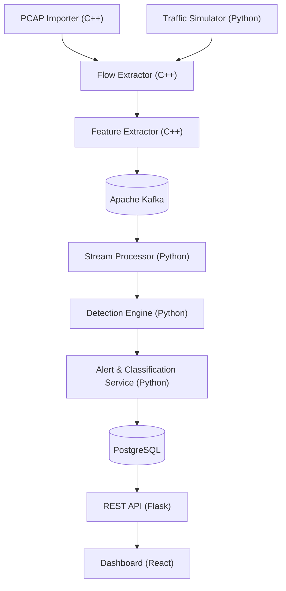
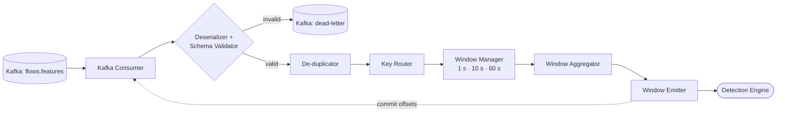
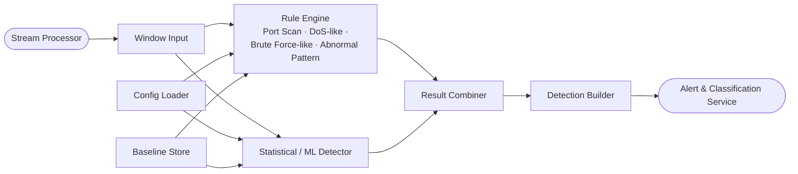
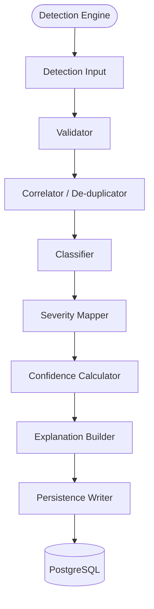
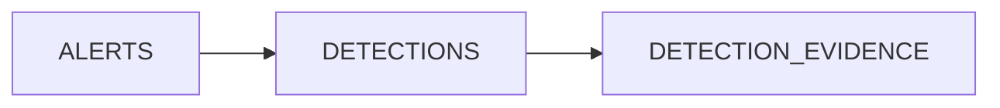

# NetGuard Architecture

## Data flow

1. Ingestion: The PCAP importer or traffic simulator supplies input data.
2. Extraction: The flow extractor converts packet data into normalized flows.
3. Feature Computation: The feature extractor calculates features and publishes events to Kafka.
4. Stream Processing: The stream processor analyzes events in time windows.
5. Detection: The detection engine identifies anomalies using rules and a second analytical method.
6. Classification: The alert and classification service assigns severity, confidence, and explanatory evidence.
7. Persistence: PostgreSQL persists flows, detections, configuration, and history.
8. Visualization: The Flask REST API exposes the data to the React dashboard.

---

# Component Diagrams

One diagram per component of the main diagram. Rounded nodes `([ ])` are neighbouring components, cylinders `[( )]` are data stores, and rectangles are subcomponents.

## A. PCAP Importer (C++)

Main Purpose: Ingests prepared static PCAP or PCAPNG network traffic files and validates input data before stream processing.

Key Sub-components:
	CLI / File Loader & Packet Reader: Supplies the initial interface to load capture files from disk and read individual packets.
	Format Detector & Input Validator: Detects file encodings and validates incoming packet structures to ensure data integrity.
	Rejection Logger: Captures and logs malformed or invalid input files safely.
	Replay Rate Controller & Import Job Tracker: Controls the replay speed of packets and tracks active import jobs and processing counts.

## B. Traffic Simulator (Python)

Main Purpose: Generates safe, controlled synthetic normal traffic and predefined anomalous scenarios without interacting with live production networks.
 
Key Sub-components:
	Scenario & Load Controllers: Manages YAML-based configuration settings and dynamic load parameters for testing.
	Traffic Generators: Implements specialized generators for normal traffic, Port Scans, DoS-like floods, Brute Force-like behavior, and Abnormal Patterns.
	Packet Builder & Output Writer: Constructs synthetic packets and writes generated flows downstream.
	Label Writer: Outputs ground-truth labels tied to scenario phase changes for evaluation metrics.

## C. Flow Extractor (C++)

Main Purpose: Normalizes raw packet streams coming from importers or simulators into a uniform network flow model.

Key Sub-components:
	Packet Source & Decoder: Decodes incoming packet payloads and logs malformed errors.
	Flow Key Builder & Flow Table: Creates unique flow keys and maintains an active table of ongoing connections.
	Flow Updater & Expiry Manager: Updates active flow states and evicts finished or timed-out flows.
	Flow Normalizer: Standardizes attributes (timestamps, durations, endpoints, counts, flags) before sending them to feature extraction.

## D. Feature Extractor (C++)

Main Purpose: Computes high-level temporal, volume, and connection-related metrics from normalized flows.

Key Sub-components:
	Flow Input Queue & Per-Flow Feature Calculator: Manages incoming flow streams and calculates metrics such as packets/sec, bytes/sec, and unique ports.
	Event Serializer & Kafka Producer: Serializes calculated feature events and publishes them directly to Apache Kafka.
	Delivery Error Handler: Handles failed network sends, managing automatic retries and dead-letter routing.

## E. Apache Kafka

Main Purpose: Acts as the mandatory centralized event transport and message broker ensuring loose coupling across distributed platform components.

Key Sub-components:
	Primary Feature Topic (flows.features): Distributes serialized feature events keyed by source IP.
	Dead-Letter Topic: Captures failed or invalid events for diagnostic review.
	Consumer Groups: Manages offset commits and reliable stream consumption for downstream processing.

## F. Stream Processor (Python)

Main Purpose: Continuously consumes and processes event streams across multiple time windows.

Key Sub-components:
	Consumer, Deserializer & Schema Validator: Ingests Kafka messages, validates structures, and routes invalid data to the dead-letter queue.
	De-duplicator & Key Router: Cleans duplicate flows and routes keys appropriately.
	Window Manager & Aggregator: Aggregates streaming data across mandatory 1 s, 10 s, and 60 s windows before emitting results to detection.

## G. Detection Engine (Python)

Main Purpose: Identifies network anomalies and attacks using dual independent analytical methodologies.

Key Sub-components:
	Rule Engine: Deterministically detects Port Scans, DoS-like floods, Brute Force attempts, and Abnormal Connection Patterns using configurable parameters.
	Statistical / ML Detector: Implements secondary methods (e.g., Z-scores, moving statistics, or Isolation Forest) to catch anomalies.
	Config Loader, Baseline Store & Result Combiner: Manages system configuration, references historical baselines, and combines rule and statistical outputs into structured detections.

## H. Alert & Classification Service (Python)

Main Purpose: Validates, classifies, and enriches raw anomalies with severity ratings, confidence levels, and human-readable explanations.

Key Sub-components:
	Validator & Correlator/De-duplicator: Validates incoming alerts and groups duplicate or related events.
	Classifier & Severity Mapper: Assigns standardized categories and maps severity levels (LOW/MEDIUM/HIGH/CRITICAL).
	Confidence Calculator & Explanation Builder: Computes confidence scores ($0-1$) and builds textual explanations containing key feature evidence.
	Persistence Writer: Securely writes classified alerts into the PostgreSQL database.

## I. PostgreSQL

Main Purpose: Serves as the relational persistence layer for alerts and the detection information behind them, written by the Alert & Classification Service and read by the REST API.

Key Sub-components:
	Alerts Table: Stores each operator-facing alert, which groups one or more related detections (same source and type in consecutive windows).
	Detections Table: Stores individual detections with their ID, timestamp, type, severity, confidence, source, destination, time window, detection method, and textual explanation.
	Detection Evidence Table: Stores the key feature values behind each detection, together with the threshold or baseline they were compared against.

## J. REST API (Flask)

Main Purpose: Exposes platform data, history, statistics, and administrative endpoints securely to the frontend dashboard.

Key Sub-components:
	Security Modules: Rate limiters, JWT authentication modules, and role guards enforcing user and admin separation.
	Input Validators & Resource Blueprints: Validates external payloads and exposes blueprints for /auth, /traffic, /flows, /detections, /history, /stats, /config, and /health.
	Data Access Layer & Audit Logger: Interfaces with PostgreSQL and logs important administrative actions securely.

## K. Dashboard (React)

Main Purpose: Provides security operators and analysts with a responsive web-based visual interface for monitoring traffic, alerts, and historical data.

Key Sub-components:
	Authentication & Client Management: Login pages, token stores, and centralized API clients communicating with backend services.
	View Router & Monitoring Panels: Routers directing views to Live Monitoring, Alert Feeds, History/Filter Panels, and Statistics.
	Investigation Tools: Detection Details, Trace Views, and restricted Admin Configuration pages.

