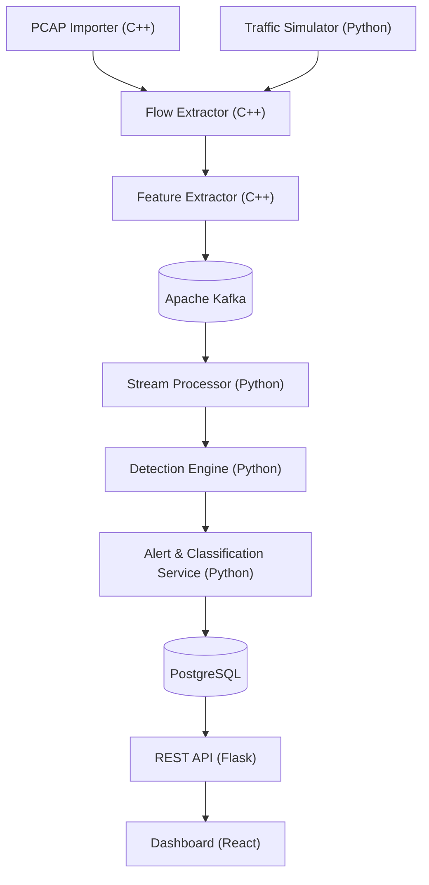
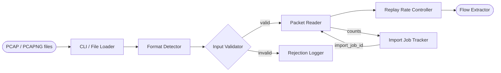
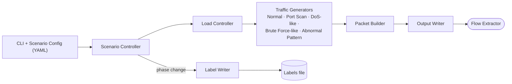
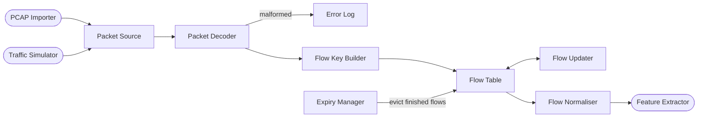
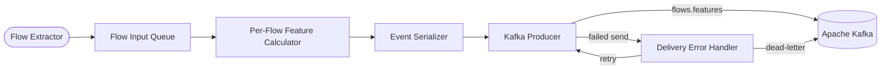
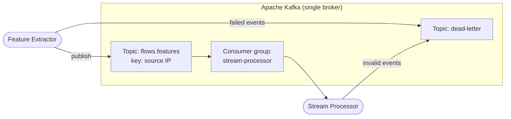
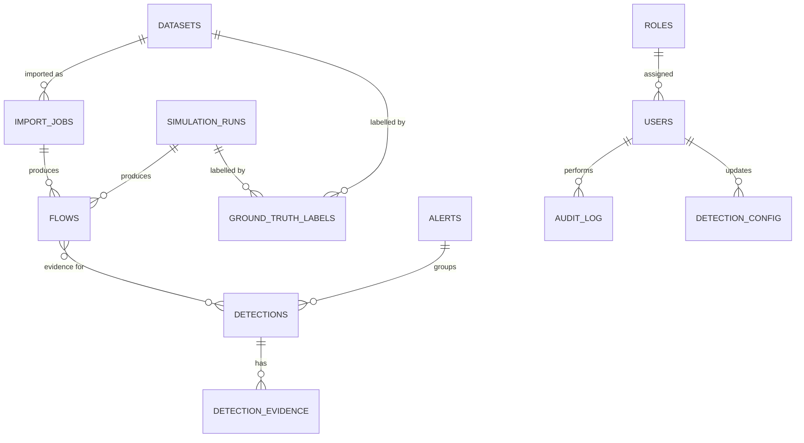
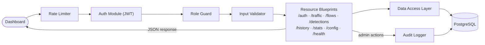
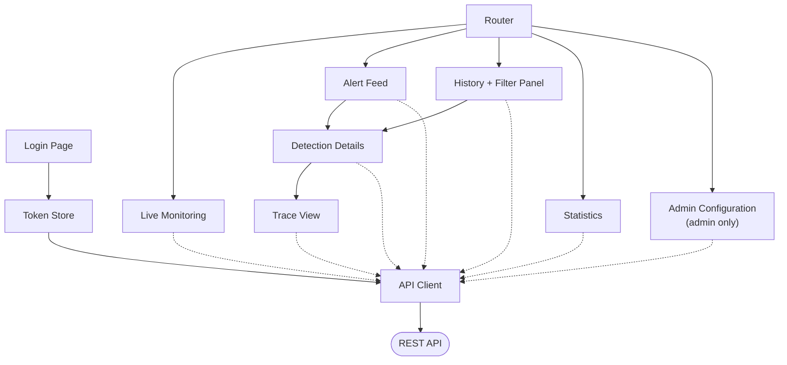

# NetGuard Architecture

## Data flow

1. The PCAP importer or traffic simulator supplies input data.
2. The flow extractor converts packet data into normalized flows.
3. The feature extractor calculates features and publishes events to Kafka.
4. The stream processor analyzes events in time windows.
5. The detection engine identifies anomalies using rules and a second analytical method.
6. The alert and classification service assigns severity, confidence, and explanatory evidence.
7. PostgreSQL persists flows, detections, configuration, and history.
8. The Flask REST API exposes the data to the React dashboard.

---

# Component Diagrams

One diagram per component of the main diagram. Rounded nodes `([ ])` are neighbouring components, cylinders `[( )]` are data stores, and rectangles are subcomponents.

## A. PCAP Importer (C++)

## B. Traffic Simulator (Python)

## C. Flow Extractor (C++)

## D. Feature Extractor (C++)

## E. Apache Kafka

## F. Stream Processor (Python)

## G. Detection Engine (Python)

## H. Alert & Classification Service (Python)

## I. PostgreSQL

## J. REST API (Flask)

## K. Dashboard (React)

